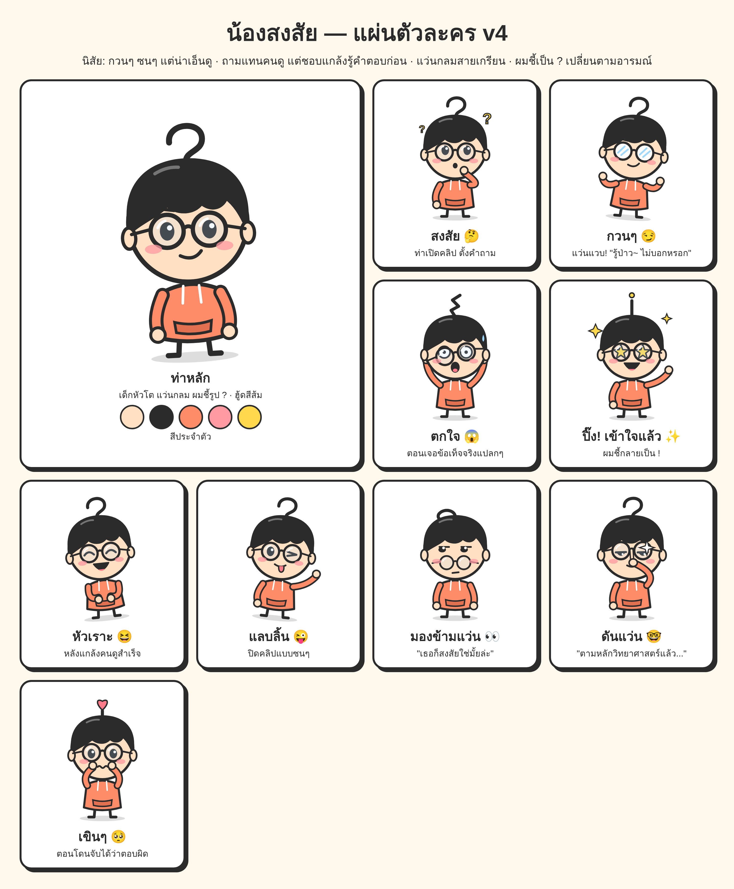

# น้องสงสัย Studio

โปรเจกต์ผลิตคลิป TikTok "สงสัยรอบตัว" ด้วยตัวละคร **น้องสงสัย** ทำโดยทีม AI agent 7 ตัว + โปรดิวเซอร์ "นิค"

- คำสั่งโปรดิวเซอร์และ pipeline: [`CLAUDE.md`](CLAUDE.md)
- คู่มือรายการ: [`docs/show-bible.md`](docs/show-bible.md)
- ทีม agent: [`.claude/agents/`](.claude/agents)
- ตัวละคร: [`character/`](character) · 
- เครื่องมือเสียง: [`tools/audio/`](tools/audio) · เสียงประกอบจากโค้ด: [`tools/sfx/`](tools/sfx)
- ตอนต่างๆ: [`episodes/`](episodes) (เริ่มจาก `_template/`)
